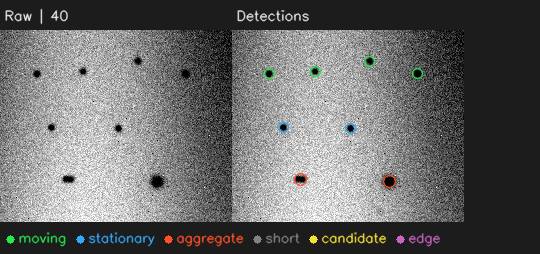

# 显微微球识别与测速

从明场视频或连续原图中寻找单球，剔除疑似团聚体、静止斑点和无法持续追踪的目标，导出相邻帧的位移和表观速率。单张照片也可以生成候选标注。下图是带已知真值的模拟样本，左为输入，右为标注。绿色为运动单球，蓝色为静止，红色为疑似团聚体，灰色为短轨迹，紫色为边界目标。单帧中的黄色表示待验证候选。



## 在自己的样品上运行

使用 Python 3.10 或更新版本。在同一倍率、分辨率和拍摄设置下，放大原始帧，横穿几颗彼此分离的清晰小球量灰度剖面，取半高宽的中位数作为单球直径（像素）。例如暗球的局部背景为 170、中心为 90，则取灰度 130 处左右两交点的间距。下面的 5 px 只是示例值。

```sh
python -m pip install -r requirements.txt
python track.py frame.png --diameter-px 5 --out results/still
python track.py clip.mp4 --diameter-px 5 --overlay-video --out results/clip
```

支持常见视频、单张 8 位图像、帧号连续且以数字结尾的 PNG/JPEG/单页 TIFF 等序列。彩色输入取绿通道。每次指定新的输出目录。视频默认按容器标称帧率计算，等间隔采集的原图序列可指定 `--fps`。对于慢动作、导出改帧率或变帧率的视频，应核对采集时间，按等间隔原始片段分析。用载物台测微尺在同一设置下标定长度后可传入 `--um-per-px`。下面的帧率和空间标定仅用于演示参数写法。

```sh
python track.py frames/ --diameter-px 5 --fps 20 --um-per-px 0.2 --out results/calibrated
```

## 筛选与复核

1. 两个尺度的高斯滤波估计背景和颗粒对比度，依据本帧的中位绝对偏差设置检测阈值。亮球用 `--polarity bright`。孤立单球明显漏检时先核对极性和直径，再尝试降低 `--snr`（默认 5）。
2. 围绕强峰测量连通轮廓，按半峰高面积、长短轴比和局部峰数筛出过大、细长或有多个峰的目标。接触图像边界的轮廓单独标记。严重重叠且外观仍像单球的颗粒可能通过筛选，离焦的孤立单球也可能被剔除。
3. 在相邻两帧中，仅连接搜索半径内互为唯一候选的目标。交叉、漏检和团聚时会断轨。可用 `--link-px` 指定搜索半径，默认一个单球直径。片段数可能大于独立粒子数。
4. 默认至少连续 8 帧。分别计算每段轨迹两个方向的第 10 至 90 百分位跨度，其合成长度不超过阈值时标为静止。默认阈值为单球直径的四分之一。用视野中已知固定斑点的定位抖动校准 `--motion-px`，短轨迹或很慢的运动可能被筛掉。画面有共同平移且有清晰固定纹理时，可开启 `--stabilize`，按第一帧做平移配准，并在对齐后的坐标中测速。配准后应检查固定点的剩余位移。

| 输出 | 含义 |
| --- | --- |
| preview.png / 可选 overlay.mp4 | 原图与标注并排；视频可逐帧核对团聚、固定斑点和断轨。未指定采集频率时预览按 10 fps 播放 |
| tracks.csv | 各帧位置、估计直径、轨迹编号和筛选结果，保留被剔除目标供复核 |
| steps.csv | 仅运动单球的连续步。dx_px、dy_px 给出有符号位移，step_px 为长度。speed_px_s 需要帧率，speed_um_s 还需要像素标定 |
| summary.json | 分类别的检出数、轨迹段数、有效步数、速度中位数及参数 |
| registration.csv | 开启配准时相对首帧的平移量和相关响应 |

每一步的表观速率为平面位移长度除以采样间隔。布朗运动的这个数值随帧间隔、曝光和定位噪声改变，比较不同样品时应统一采集和筛选参数。单帧只输出形态候选和空速度表。缺少时间或长度标定时，相应的速率字段留空。

## 验证

```sh
python check_truth.py
```

默认测试生成 80 帧，包含 4 颗运动单球、2 个固定点、1 个移动双球和 1 个移动大斑点，还加入了光照起伏、相机噪声、脉冲噪声和轻微整体抖动。程序通过命令行入口运行，按已知坐标核对身份、筛除结果和速度。默认种子中，316 个真实单球步长全部匹配，固定点和团聚体均未混入速度表。定位均方根误差 0.097 px，20 fps 下速率平均绝对误差 1.51 px/s。

另用公开的水中 1 µm 乳胶球实拍序列跑通了 300 帧。按单球表观宽度 4 px、24 fps、2.85 px/µm 运行，得到 98,560 个有效步长。公开样片没有逐粒子真值，这个数用于复现流程。实际 40× 样品的筛选效果仍须结合其原始连续画面核对。[Trackpy 原始数据和采集说明](https://github.com/soft-matter/trackpy-examples/tree/09fb3074a173585d48b5001b5b4b7e6479999598/sample_data/bulk_water)

## 从原视频抽几帧复核

用完整的一段连续画面判定运动状态，再导出其中几个时刻的截图。下例取 7 fps 视频的第 140 至 210 帧（含两端，20–30 秒），CSV 和截图都使用原视频从 0 开始的帧号。先用单球的表观宽度和固定斑点的定位抖动确定各自视频所需的阈值。

```sh
python track.py clip.mp4 --start-frame 140 --frame-count 71 --diameter-px 5.5 --snr 7 --link-px 6 --min-frames 15 --motion-px 3 --overlay-video --out results/review
python review_frames.py clip.mp4 results/review --frames 154 161 168
```

`moving_track_speeds.csv` 每行对应一个通过筛选的连续单球轨迹段，平均速率按总路径长度除以持续时间计算。`steps.csv` 每行对应其中一对相邻帧，轨迹较长的颗粒贡献的步数更多。这两种统计给出的平均值可以不同。固定参照保持原位而许多颗粒共同向一侧移动时，以画面为参考的速率含有共同流动的贡献。

## 区分平台平移与颗粒群共同运动

下例复现 40× 视频整段的分析。把命令中的 `clip.mp4` 换成原视频路径。坐标仅适用于该片。其他视频需要在清晰参考帧中重新选择分布在不同位置的固定纹理，并留出一组独立验证点。导出 H.264 视频需要系统路径下有支持 libx264 的 FFmpeg。

```sh
python track.py clip.mp4 --diameter-px 5.5 --snr 7 --link-px 6 --min-frames 15 --motion-px 3 --out results/40x-full
python fiducial_drift.py clip.mp4 --reference-frame 161 \
  --mark 38,158 488,124 1113,78 61,385 513,355 789,346 746,472 1109,471 341,499 982,704 \
  --holdout 342,57 785,74 456,195 1124,275 207,587 1109,723 --out results/40x-reference-checked
python analyze_motion.py results/40x-full results/40x-reference-checked/shift.csv
python motion_figures.py results/40x-full/correction
python render_motion_video.py clip.mp4 results/40x-full
```

1. 运动单球的筛选沿用前面的形态、连续性和运动跨度要求。用固定纹理在每一帧相对同一参考帧测量平移，再用相邻帧的平移差校正单球的 x、y 位移。只有图像纹理确实固定于样品池时，测得的共同平移才能直接代表载物台相对相机的平移。低置信度的平移保留为空值。
2. 按轨迹编号将单球随机分为两组（固定种子）。逐帧用另一组至少 8 颗单球的 x、y 位移中位数估计共同运动，从本颗粒位移中扣除后再计算速率。对所有颗粒进行相同的平移参照校正后再去除共同运动，与直接在相机坐标中去除颗粒群共同运动具有相同残差。该步骤可以去掉整体输运，不能单独确定输运的物理来源。
3. 速度分布图仅纳入三种速率都有数据的同一批相邻帧位置对。二维均方位移（MSD）由同一轨迹上连续有效的步长累计得到，避免跨越缺帧或参照失效的区间。各时间间隔按有效位置对数加权。表观扩散系数取短时线性拟合斜率的四分之一；另用对数斜率检查 MSD 与时间是否近似成正比。较长的轨迹贡献较多位置对，结果受运动筛选、定位噪声及剩余流动影响。

结果目录 `correction` 包含标注视频 `annotated.mp4`、速度分布图 `speed_distribution.png` 和均方位移图 `msd.png`。`steps.csv.gz` 与 `moving_segments.csv` 分别记录逐步和逐段速率，`drift.csv` 记录逐帧参照平移差与全体运动单球代表位移，`msd.csv` 给出 MSD 及有效位置对数。视频右侧三条例子使用与速度表相同的残差。
